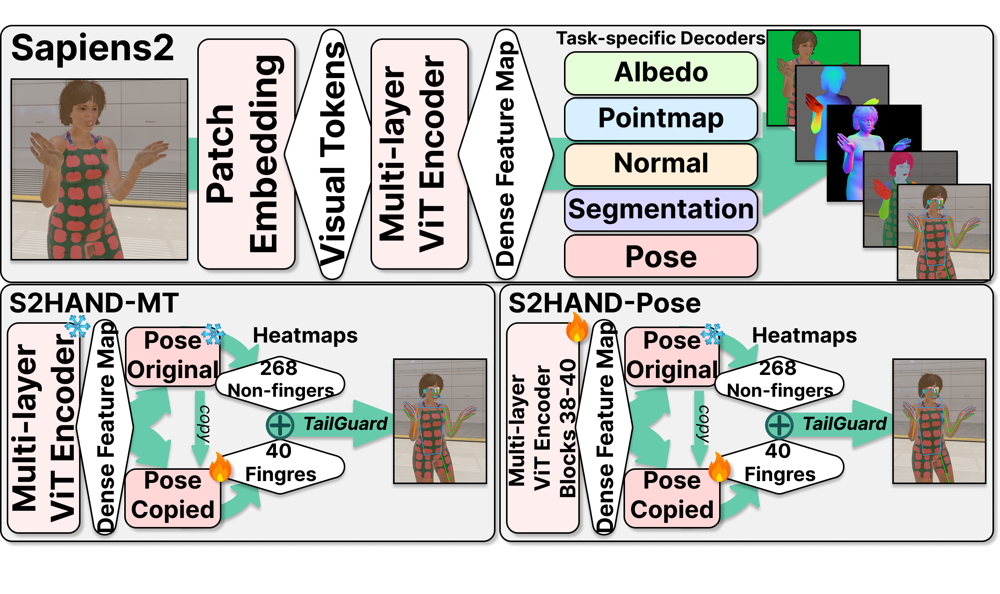

# S2HAND

**Accuracy-Preservation Trade-Offs for Hand Specialization in Whole-Body Pose
Models**

Singyu Muk · Xuanren Song · Kalin Stefanov

[](https://huggingface.co/mage0001/S2HAND)
[](https://huggingface.co/datasets/mage0001/H2SMV-FPV)
[](pyproject.toml)
[](LICENSE.md)

**[Models](https://huggingface.co/mage0001/S2HAND) ·
[H2SMV-FPV generator](https://huggingface.co/datasets/mage0001/H2SMV-FPV) ·
[Training](docs/TRAINING.md) · [Evaluation](docs/EVALUATION.md) ·
[TailGuard](docs/TAILGUARD.md)**

S2HAND specializes the hand predictions of Sapiens2 while retaining its native
308-keypoint whole-body pose interface. It avoids combining an independent hand
model with a body model, which otherwise introduces another detector, coordinate
alignment, and wrist-stitching decisions.

> This repository is being prepared privately while the accompanying manuscript
> is under review. Interfaces and documentation may change before public release.

<p align="center">
  
</p>

## News

- **2026-10-30:** Prepared the private release candidate with five model deltas,
  standalone loading, training/evaluation code, TailGuard, and the H2SMV-FPV
  generator. See the [changelog](CHANGELOG.md).

## Highlights

- One 308-keypoint whole-body interface: no separate hand model, coordinate
  conversion, or wrist stitching at deployment.
- Two explicit operating points: exact protected routing with **S2HAND-MT**, or
  stronger hand accuracy with audited shared-backbone changes in
  **S2HAND-Pose**.
- Five released model deltas spanning 0.4B to 5B Sapiens2 bases.
- Reproducible native-pipeline, shared-crop, Fisher, TailGuard, and downstream
  evaluation tools.
- Public release will include source, weights, and the asset-free H2SMV-FPV
  generation recipe.

## Native-pipeline results

AUC@0.20 in percent; higher is better. Each system uses its declared deployable
detector/crop pipeline, missed hands count as failures, and TailGuard is off.
EPICK is a validation split and H2SMV-FPV is synthetic.

| Model | NewDays TEST | VISOR TEST | H2O TEST | EPICK VAL | H2SMV-FPV TEST |
|---|---:|---:|---:|---:|---:|
| Public Sapiens2-5B | 61.48 | 56.12 | 69.02 | 55.16 | 47.93 |
| RTMPose-Hand5 | 59.72 | 63.51 | 67.43 | 64.10 | 40.57 |
| EffHandEgoNet-H2O | 5.20 | 32.25 | **75.25** | 29.11 | 8.37 |
| S2HAND-MT-5B (ours) | 62.57 | 59.42 | 70.79 | 58.54 | 49.01 |
| **S2HAND-Pose-5B (ours)** | **70.04** | **74.88** | 73.96 | **74.35** | **56.14** |

See [docs/EVALUATION.md](docs/EVALUATION.md) for normalization, strict miss
handling, coordinate schemas, and commands. Published HandOS PCK comparisons
use a different reported metric subset and are therefore kept in the paper
table rather than mixed into this AUC table.

## Which model should I use?

| Need | Recommended model |
|---|---|
| Exact public routing for all 268 non-finger heatmaps and unchanged auxiliary heads | `S2HAND-MT-5B` |
| Best released hand accuracy | `S2HAND-Pose-5B` |
| Lower memory/compute while retaining the same 308-point interface | `S2HAND-Pose-0.4B`, `0.8B`, or `1B` |
| Fewer severe hand failures when a hand detector is already available | Add optional `TailGuard` |

## Variants

- **S2HAND-MT-5B** adds a lightweight copied pose decoder. The adapted route
  supplies the 40 non-wrist finger heatmaps; the public route supplies the other
  268 body, foot, face, and wrist heatmaps. The shared Transformer and auxiliary
  task heads remain unchanged.
- **S2HAND-Pose** also updates three Fisher-selected Transformer blocks and the
  hand decoder, trading exact preservation for stronger hand recovery. We provide
  0.4B, 0.8B, 1B, and 5B variants.
- **TailGuard** is an optional confidence-triggered re-cropping policy. It is not
  another pose model and does not change the checkpoint.

## Checkpoints

S2HAND checkpoints are distributed as trainable deltas in the private
[`mage0001/S2HAND`](https://huggingface.co/mage0001/S2HAND) repository. The
loader retrieves the exact official Sapiens2 base, verifies both SHA-256 hashes,
applies the delta, and reconstructs the protected decoder route.

| Model | Updated Transformer blocks (zero-based) | Delta size |
|---|---:|---:|
| S2HAND-MT-5B | none | 3.31 MiB |
| S2HAND-Pose-0.4B | 16--18 | 195.50 MiB |
| S2HAND-Pose-0.8B | 17--19 | 284.78 MiB |
| S2HAND-Pose-1B | 28--30 | 410.58 MiB |
| S2HAND-Pose-5B | 38--40 | 1019.04 MiB |

Official base checkpoints are not duplicated in this repository.
The pinned base revisions, delta hashes, Hugging Face revisions, and TailGuard
configuration are collected in [release_manifest.json](release_manifest.json).
The hand objective, data roles, routing, and Fisher-selected block policy are
documented in [docs/TRAINING.md](docs/TRAINING.md).
The two final 5B variants branch independently from a released compact common
training warm-start; that artifact is clearly marked non-deployment.
The no-update block-selection probe and its cached-batch schema are documented
in [docs/FISHER.md](docs/FISHER.md).
The aligned 2D hand schemas and strict paper metrics are documented in
[docs/EVALUATION.md](docs/EVALUATION.md).
The standalone HInt directory contract and source-balanced training adapter
are documented in [docs/DATA.md](docs/DATA.md).
The non-Slurm end-to-end MT/Pose optimizer and HInt checkpoint selector are
available as `tools/train.py` and documented in [docs/TRAINING.md](docs/TRAINING.md).

## Release map

| Component | Location | Contents |
|---|---|---|
| Source | this GitHub repository | installable package, CLI tools, tests, training and evaluation protocols |
| Model zoo | [Hugging Face S2HAND](https://huggingface.co/mage0001/S2HAND) | five deployment deltas, manifests, hashes, and standalone loader |
| Synthetic audit set | [Hugging Face H2SMV-FPV](https://huggingface.co/datasets/mage0001/H2SMV-FPV) | frozen split/schema and asset-free Blender generation recipe |

Official Sapiens2 bases and benchmark datasets are not mirrored. The manifests
pin the required upstream model revisions, and each dataset remains under its
own terms. See [THIRD_PARTY_NOTICES.md](THIRD_PARTY_NOTICES.md).

## Installation

Python 3.12 and PyTorch 2.7 or newer are recommended.

```bash
git clone https://github.com/ronggong000/S2HAND.git
cd S2HAND
pip install -e .
hf auth login  # required while the model repository is private
```

## Load a model

```python
import torch
from s2hand import load_model

model = load_model("S2HAND-Pose-0.4B", device="cuda")

# Person crops are RGB, Bx3x1024x768, and ImageNet-normalized.
with torch.inference_mode(), torch.autocast("cuda", dtype=torch.bfloat16):
    heatmaps = model(normalized_person_crops)  # Bx308x256x192
```

## Run on images

S2HAND is a top-down estimator and therefore takes a person box. Create a TSV
with one row per person:

```text
images/example.jpg  x1  y1  x2  y2
```

Then run the same 1.25x padded 3:4 crop, UDP affine transform, ImageNet
normalization, and UDP/DARK decoder used in our evaluation:

```bash
python tools/infer.py \
  --model S2HAND-Pose-0.4B \
  --inputs people.tsv \
  --output predictions.npz \
  --device cuda \
  --batch-size 4
```

The output contains all 308 keypoints in original-image coordinates and their
heatmap scores. Person detection is intentionally external so detector and crop
protocols remain explicit. This command performs D0 inference without horizontal
flip testing, matching the paper's default evaluation.

## Optional TailGuard

TailGuard uses the same S2HAND checkpoint twice: it keeps the native prediction
unless the mean confidence of a hand is at most `0.5107561469` and a matching
left/right hand-detector box exists. Triggered hands are re-run on the frozen
2x square hand-box context; all 21 joints, including the wrist, are replaced
coherently in original-image coordinates. Run the released policy with:

```bash
python tools/tailguard_infer.py \
  --model S2HAND-MT-5B \
  --person-detections person_detections.npz \
  --hand-detections hand_detections.npz \
  --output tailguard_predictions.npz \
  --device cuda
```

The detector-cache schema, fallback behavior, and output fields are documented
in [docs/TAILGUARD.md](docs/TAILGUARD.md). Detector outputs stay explicit and
are not bundled with the pose checkpoint.

## Reproducibility status

- All five deltas have manifests with their exact official base, tensor list,
  byte size, and SHA-256.
- Both 5B deltas were rebased and replayed against the public Sapiens2-5B base.
- Routed-head behavior was checked against the research implementation.
- The 0.4B full backbone and head passed a bitwise CPU smoke test on a reduced
  input.
- The 0.4B, 0.8B, and 1B variants passed fresh full-resolution A100/BF16
  deterministic replay; output hashes are recorded in their manifests. See
  [VALIDATION.md](VALIDATION.md).
- S2HAND-Pose-5B passed a complete near-exact HInt validation replay, and the
  real S2HAND-MT-5B 40/268 route passed bitwise protected-channel validation.

Run the release unit tests with:

```bash
pytest -q
```

`VALIDATION.md` separates CPU/unit checks from full-resolution GPU replay so a
passing lightweight test is never presented as a full checkpoint reproduction.

## License

S2HAND is derived from Sapiens2. The code and model artifacts in this repository
are distributed under the included [Sapiens2 License](LICENSE.md), not MIT.
See [THIRD_PARTY_NOTICES.md](THIRD_PARTY_NOTICES.md) for external components.

## Citation

The manuscript is under review. The public bibliographic record will replace
this temporary entry when available.

```bibtex
@misc{muk2027s2hand,
  title  = {S2HAND: Accuracy-Preservation Trade-Offs for Hand Specialization in Whole-Body Pose Models},
  author = {Muk, Singyu and Song, Xuanren and Stefanov, Kalin},
  year   = {2027}
}
```

Please also cite Sapiens2 and every benchmark or downstream system used in your
experiment.

## Acknowledgements

S2HAND builds on Meta's Sapiens2 and uses HInt, COCO WholeBody, FreiHAND, H2O,
DexYCB, AssemblyHands, Pose2Mesh, WiLoR, and Uni-Sign for research evaluation.
Their licenses and official distributions remain independent of this project.

## Contact

Singyu Muk — `ronggong000@gmail.com`
